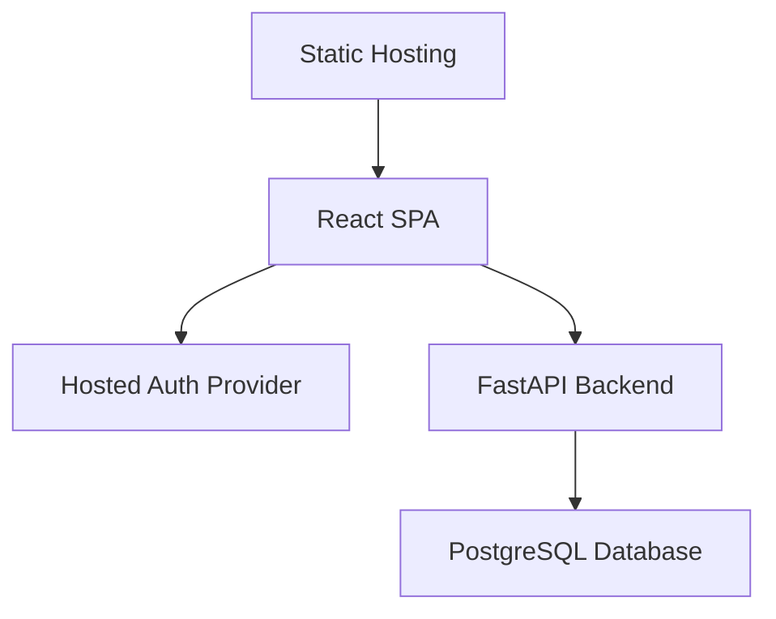
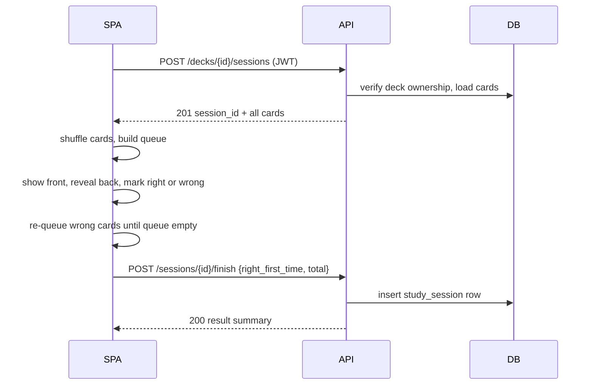
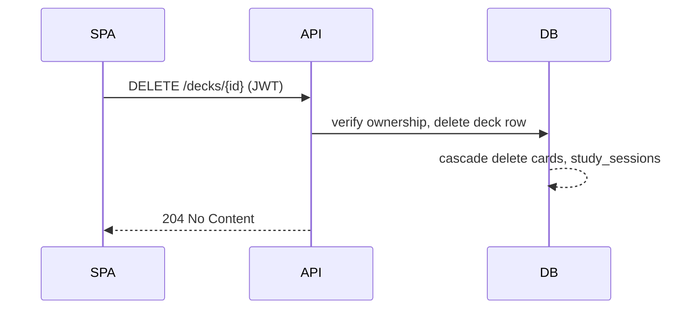
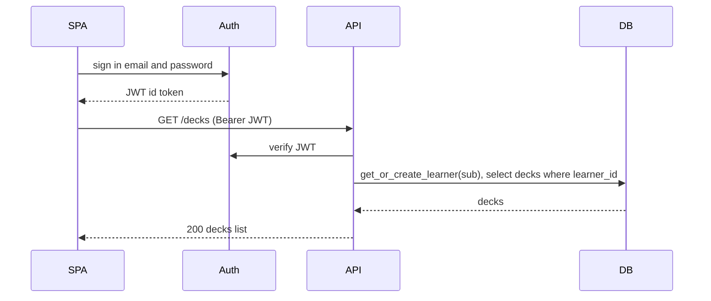
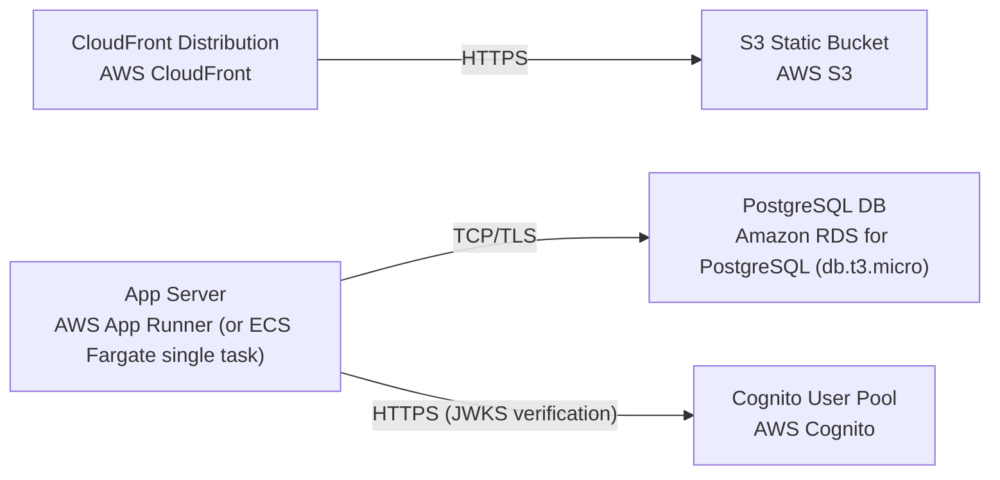

# Architecture

> Maintained by QuorQ AI SDLC. Text between `sdlc:auto` markers is regenerated; anything outside them is yours and is kept.

<!-- sdlc:auto:start narrative -->
## Overview

### ARCH-OVERVIEW · approved · source: architecture:components

Approved (v1) architecture: a responsive React SPA served from AWS, a FastAPI REST backend, PostgreSQL storage, and AWS Cognito for email/password auth -- all private-per-learner, on a single small managed instance.

Components: spa (React SPA, TypeScript) renders auth, deck list, deck/card management, study flow, results; manages client auth state and calls API with JWT. auth_provider (AWS Cognito User Pools) handles sign-up/in/out and JWT issuance, email+password only, no social/SSO. api (FastAPI backend) exposes REST endpoints for decks/cards/sessions/history, validates JWT, enforces per-learner isolation, applies cascade deletes. db (PostgreSQL) stores learners, decks, cards, study_sessions. static_host (AWS S3 + CloudFront) serves built SPA assets over HTTPS.

**Related:** EPIC-001, EPIC-002, EPIC-003, EPIC-004, EPIC-005, EPIC-006

### ARCH-CP-STUDY · approved · source: architecture:critical-path:study-session-lifecycle

Defines how a study session flows end to end between SPA and backend.

Learner starts a session on a deck; backend returns all cards; SPA shuffles them client-side; presents each card front, reveals back, marks right/wrong; re-queues wrong cards until all correct; SPA then posts the completed score, which is persisted to history via POST /sessions/{id}/finish.

**Related:** US-013, US-014, US-015, US-016, US-017, US-018

### ARCH-CP-DELETE · approved · source: architecture:critical-path:deck-deletion-cascade

Defines the cascade behavior when a learner deletes a deck.

Learner confirms deck deletion; backend deletes the deck row and cascades deletion of all cards and study_sessions rows belonging to that deck and learner, via DELETE /decks/{id}.

**Related:** US-008

### ARCH-CP-AUTH · approved · source: architecture:critical-path:sign-in-and-private-data-access

Defines how sign-in establishes identity and scopes all data access.

Learner signs in via Cognito and receives a JWT; the API uses the JWT to scope all deck/card/session queries to that learner only, enforcing the per-account privacy requirements.

**Related:** US-002, US-004

### ARCH-DATA-MODEL · approved · source: architecture:entities

Relational schema backing learners, decks, cards, and study sessions.

learners: id, auth_subject, email, created_at. decks: id, learner_id, name, created_at, updated_at. cards: id, deck_id, front, back, ordinal, created_at, updated_at. study_sessions: id, deck_id, right_first_time, total_cards, completed_at.

**Related:** EPIC-001, EPIC-002, EPIC-003, EPIC-005

- ⚠ study_sessions has a deck_id but no explicit learner_id column shown; per-learner scoping for session queries presumably relies on joining through decks.learner_id, but this join path is not explicitly confirmed in the input.

### ARCH-API · approved · source: architecture:endpoints

REST API surface for learner, deck, card, and session operations.

POST /auth/learners (get-or-create local learner row post sign-in). GET /decks (list with card counts). POST /decks (create). PATCH /decks/{id} (rename). DELETE /decks/{id} (delete + cascade). GET /decks/{id}/cards (list cards). POST /decks/{id}/cards (add card). PATCH /cards/{id} (edit card). DELETE /cards/{id} (delete card). POST /decks/{id}/sessions (start session, returns all cards). POST /sessions/{id}/finish (record completed score). GET /decks/{id}/sessions (list session history, most recent first).

**Related:** US-001, US-004, US-005, US-006, US-007, US-008, US-009, US-010, US-011, US-012, US-013, US-018, US-019

### ARCH-DEPLOY · approved · source: architecture:deployment-nodes

Deployment topology: CDN-fronted static SPA, single-task API server, managed Postgres, managed auth.

CloudFront Distribution (managed CDN) in front of an S3 Static Bucket (SPA assets). App Server on AWS App Runner (or ECS Fargate single task) running FastAPI on Uvicorn. PostgreSQL DB via Amazon RDS (db.t3.micro). Cognito User Pool for managed auth. Sized for a single small instance appropriate to tens of users.

**Related:** EPIC-006

### ARCH-TECH-FRONTEND · approved · source: architecture:technology-decisions:frontend

Frontend: React (TypeScript), approved stack.

Chosen over Vue/Svelte alternatives. A single responsive SPA renders deck list, card management, study flow, and results; TypeScript keeps session-shuffle and queue logic type-safe.

**Related:** REQ-TECHSTACK

### ARCH-TECH-BACKEND · approved · source: architecture:technology-decisions:backend

Backend: FastAPI (Python), approved stack.

Chosen over Node/Express and Django alternatives. FastAPI provides Pydantic validation for deck/card/session payloads and JWT dependency injection for per-learner scoping with minimal boilerplate.

**Related:** REQ-TECHSTACK

### ARCH-TECH-DB · approved · source: architecture:technology-decisions:database

Database: PostgreSQL, approved stack.

Chosen over MySQL and SQLite alternatives. Holds learners, decks, cards, and study_sessions with FK cascade deletes for deck removal.

**Related:** REQ-TECHSTACK

### ARCH-TECH-CLOUD · approved · source: architecture:technology-decisions:cloud

Cloud: AWS, approved stack.

Chosen over GCP and Azure alternatives. S3+CloudFront serves the SPA, App Runner/Fargate runs FastAPI, RDS runs PostgreSQL, Cognito handles email-and-password auth.

**Related:** REQ-TECHSTACK

### ARCH-TECH-AUTH · approved · source: architecture:technology-decisions:auth

Auth: AWS Cognito User Pools, chosen over Auth0 and Firebase Auth.

Email-and-password-only hosted auth with JWT issuance, integrates natively with the approved AWS stack; no social login or SSO configured.

**Related:** US-001, US-002, US-003, US-004
<!-- sdlc:auto:end narrative -->

<!-- sdlc:auto:start building-blocks -->
## Building Block View

| ID | Name | Technology | Responsibility | Depends on |
|---|---|---|---|---|
| spa | React SPA | React (TypeScript) | Responsive UI for auth screens, deck list, deck detail/card management, study session flow, and session results. Manages client-side auth state and calls the API with a JWT. | api, auth_provider |
| auth_provider | Hosted Auth Provider | AWS Cognito User Pools | Email-and-password sign-up, sign-in, sign-out, JWT issuance. No social login or SSO. | — |
| api | FastAPI Backend | FastAPI (Python) | REST API for decks, cards, study sessions, and session history. Validates JWT, enforces per-learner data isolation, applies cascade deletes. | db |
| db | PostgreSQL Database | PostgreSQL | Stores learners (synced from auth provider), decks, cards, and study sessions with their scores. | — |
| static_host | Static Hosting | AWS S3 + CloudFront | Serves the built React SPA assets to browsers with HTTPS. | spa |

<!-- sdlc:auto:end building-blocks -->

<!-- sdlc:auto:start runtime -->
## Runtime View

### Study session lifecycle

Learner starts a session on a deck, the backend returns all cards, the SPA shuffles them, presents each card front, reveals the back, marks right/wrong, re-queues wrong cards until all are correct, then posts the completed score which is persisted to history.

- **Components:** spa, api, db, auth_provider
- **Modules:** StudySessionController, DeckService, CardService, SessionService, StudySessionView, CardQueue
- **Key functions:** start_session(deck_id), get_deck_cards(deck_id), shuffle(cards), mark_card(card_id,result), finish_session(deck_id,right_first_time,total)

### Deck deletion cascade

Learner confirms deletion of a deck; the backend deletes the deck and cascades all cards and study-session rows belonging to that deck and learner.

- **Components:** spa, api, db
- **Modules:** DeckController, DeckService
- **Key functions:** delete_deck(deck_id), cascade_delete_cards(deck_id), cascade_delete_sessions(deck_id)

### Sign-in and private data access

Learner signs in via Cognito, receives a JWT, and the API uses it to scope all queries to that learner only.

- **Components:** spa, auth_provider, api, db
- **Modules:** AuthContext, JwtMiddleware, LearnerService
- **Key functions:** sign_in(email,password), verify_jwt(token), get_or_create_learner(sub), scope_query(learner_id)

<!-- sdlc:auto:end runtime -->

<!-- sdlc:auto:start deployment-view -->
## Deployment View

| Name | Service | Runtime | Scaling | Environment |
|---|---|---|---|---|
| CloudFront Distribution | AWS CloudFront | Managed CDN | Automatic edge | dev |
| S3 Static Bucket | AWS S3 | Object storage | Automatic | dev |
| App Server | AWS App Runner (or ECS Fargate single task) | FastAPI on Uvicorn | Single small instance | dev |
| PostgreSQL DB | Amazon RDS for PostgreSQL (db.t3.micro) | Managed PostgreSQL | Single AZ, small instance | dev |
| Cognito User Pool | AWS Cognito | Managed auth | Automatic | dev |

| Source | Target | Protocol |
|---|---|---|
| CloudFront Distribution | S3 Static Bucket | HTTPS |
| App Server | PostgreSQL DB | TCP/TLS |
| App Server | Cognito User Pool | HTTPS (JWKS verification) |

<!-- sdlc:auto:end deployment-view -->

<!-- sdlc:auto:start decisions -->
## Architecture Decisions

| Layer | Choice | ADR |
|---|---|---|
| Frontend | React (TypeScript) | [ADR-0001](adr/frontend.md) |
| Backend | FastAPI (Python) | [ADR-0002](adr/backend.md) |
| Database | PostgreSQL | [ADR-0003](adr/database.md) |
| Cloud | AWS | [ADR-0004](adr/cloud.md) |
| Auth | AWS Cognito User Pools | [ADR-0005](adr/auth.md) |
<!-- sdlc:auto:end decisions -->

<!-- sdlc:auto:start links -->
## Related Documents

- [Data Model](data-model.md)
- [API Specification](api/openapi.yaml)
- [Architecture Decision Records](adr/README.md)
<!-- sdlc:auto:end links -->
