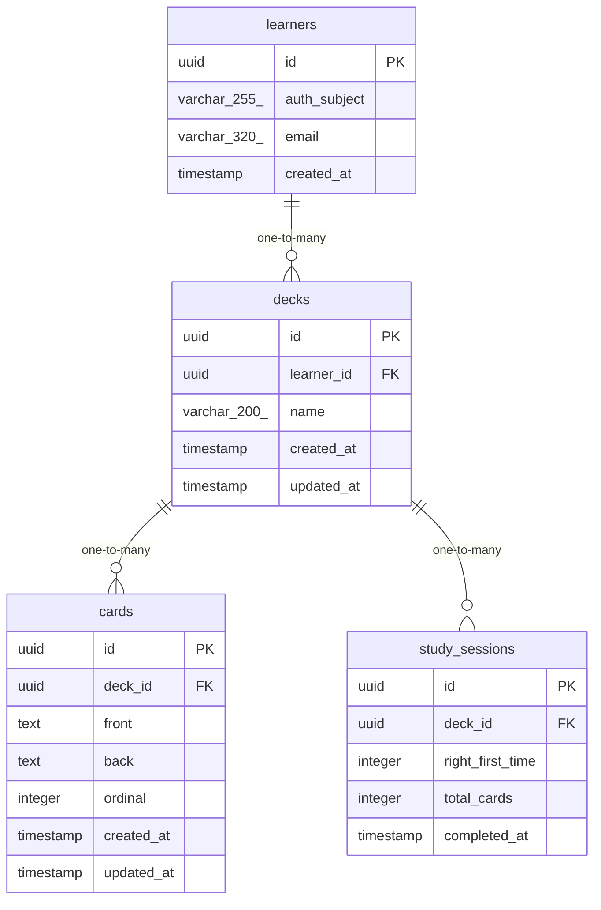

# Data Model

<!-- sdlc:auto:start entities -->
### learners

| Field | Type | PK | FK | Nullable |
|---|---|---|---|---|
| id | uuid | True | — | False |
| auth_subject | varchar(255) | False | — | False |
| email | varchar(320) | False | — | False |
| created_at | timestamp | False | — | False |

### decks

| Field | Type | PK | FK | Nullable |
|---|---|---|---|---|
| id | uuid | True | — | False |
| learner_id | uuid | False | learners.id | False |
| name | varchar(200) | False | — | False |
| created_at | timestamp | False | — | False |
| updated_at | timestamp | False | — | False |

### cards

| Field | Type | PK | FK | Nullable |
|---|---|---|---|---|
| id | uuid | True | — | False |
| deck_id | uuid | False | decks.id | False |
| front | text | False | — | False |
| back | text | False | — | False |
| ordinal | integer | False | — | False |
| created_at | timestamp | False | — | False |
| updated_at | timestamp | False | — | False |

### study_sessions

| Field | Type | PK | FK | Nullable |
|---|---|---|---|---|
| id | uuid | True | — | False |
| deck_id | uuid | False | decks.id | False |
| right_first_time | integer | False | — | False |
| total_cards | integer | False | — | False |
| completed_at | timestamp | False | — | False |
<!-- sdlc:auto:end entities -->

<!-- sdlc:auto:start relationships -->
| Source | Target | Type |
|---|---|---|
| learners | decks | one-to-many |
| decks | cards | one-to-many |
| decks | study_sessions | one-to-many |
<!-- sdlc:auto:end relationships -->

<!-- sdlc:auto:start er-diagram -->

<!-- sdlc:auto:end er-diagram -->
