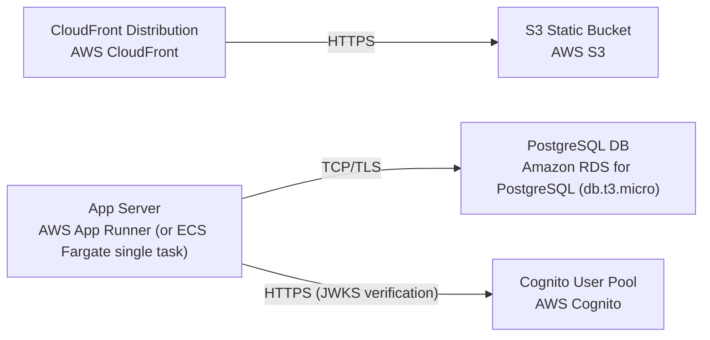

# Deployment Guide

> Maintained by QuorQ AI SDLC. Text between `sdlc:auto` markers is regenerated; anything outside them is yours and is kept.

<!-- sdlc:auto:start how-it-deploys -->
Pushes to `main` run `.github/workflows/deploy.yml`, which builds the API image (if there is a backend) and deploys the SPA to AWS Amplify. Commits touching only `docs/sdlc/**` don't deploy. Deployments can also be started from the platform's Deployment tab.
<!-- sdlc:auto:end how-it-deploys -->

<!-- sdlc:auto:start environments -->
| Name | Service | Runtime | Scaling | Environment |
|---|---|---|---|---|
| CloudFront Distribution | AWS CloudFront | Managed CDN | Automatic edge | dev |
| S3 Static Bucket | AWS S3 | Object storage | Automatic | dev |
| App Server | AWS App Runner (or ECS Fargate single task) | FastAPI on Uvicorn | Single small instance | dev |
| PostgreSQL DB | Amazon RDS for PostgreSQL (db.t3.micro) | Managed PostgreSQL | Single AZ, small instance | dev |
| Cognito User Pool | AWS Cognito | Managed auth | Automatic | dev |
<!-- sdlc:auto:end environments -->

<!-- sdlc:auto:start live -->
_Not deployed yet._
<!-- sdlc:auto:end live -->

<!-- sdlc:auto:start topology -->

<!-- sdlc:auto:end topology -->
